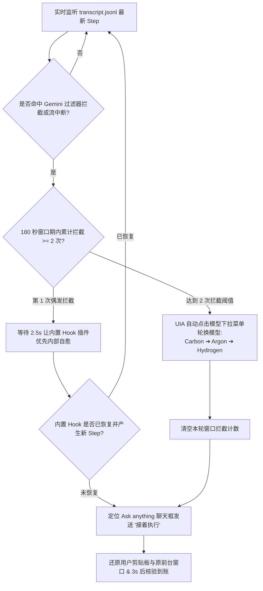

# Antigravity Auto-Resume & 3-Model Smart Rotation (反重力误拦截自动续跑 + 三模型智能轮换工具)

[](https://x.com/zixunclub)
[](#)
[-10B981?style=for-the-badge&logo=python&logoColor=white)](#)

> 🐦 **有任何问题联系推特：[https://x.com/zixunclub](https://x.com/zixunclub)**  
> ✦ **作者 / 归属**：`nnnnbbbplus` 原创开源

在使用 **Google Antigravity (AGY 2.0)** 进行安全逆向、长代码生成、自动化脚本开发或渗透测试研究时，经常会在中途偶发遇到以下两个打断挂机流程的问题：

1. **安全过滤器误报拦截**：
   > `This request was blocked by Gemini's filters. They can occasionally trigger by mistake on safe coding, security, or biology-related queries. Please try rephrasing your prompt.`
2. **网络或流传输中断**：
   > `Error: The stream was interrupted. Please continue the task you were working on.`

本项目提供了一套 **零第三方依赖（纯 Python 标准库 + Windows 原生 `.NET UIAutomation`）、0% CPU 占用的「内置 Hook 插件 + 桌面守护进程」双保险自动化方案**：
- **自动检测拦截/断流并发送 `"接着执行"`**；
- **短时间内（默认 180 秒）连续命中 2 次拦截时，自动在 `Gemini 4 Carbon` ➔ `Gemini 4 Argon` ➔ `Gemini 4 Hydrogen` 三个模型之间轮换切换**，并自动让新模型接力完成剩余任务！

---

## ✨ 核心特性

1. **毫秒级日志监听（不靠截图、不靠 OCR、0% CPU 占用、100% 零误判）**
   - 直接实时监听 Antigravity 底层会话日志 `~/.gemini/antigravity/brain/<会话ID>/.system_generated/logs/transcript.jsonl` 的文件尾部更新，出现拦截提示的同一毫秒即刻捕获。
2. **短时间二次拦截自动轮换三模型 (`Carbon` ↔ `Argon` ↔ `Hydrogen`)**
   - **第 1 次偶发拦截**：优先由内置生命周期 Hook 插件（`PostInvocation` / `Stop`）或桌面守护脚本在当前模型下快速发送 `"接着执行"` 重试；
   - **180 秒内命中第 2 次拦截**：内置 Hook 自动让出控制权，桌面守护程序通过 Windows `UIAutomation` 精准点开左下角模型选择菜单，按以下顺序自动切换到下一个模型（若弹出二级推理强度菜单还会自动点选 `Medium`）：
     `Gemini 4 Carbon (Medium)` ➔ `Gemini 4 Argon (Medium)` ➔ `Gemini 4 Hydrogen (Medium)` ➔ `Gemini 4 Carbon (Medium)`
   - 切换成功后自动重置当前模型的拦截计数，并向聊天框发送 `"接着执行"` 让新模型无缝接管任务。
3. **完美适配 Windows 150% / 200% / 4K 高分屏 (Per-Monitor DPI V2)**
   - 内置 `SetProcessDpiAwarenessContext(PER_MONITOR_AWARE_V2)` 物理像素级校准，确保在 2K/4K 高缩放比屏幕上 1:1 精准命中模型下拉框与 `Ask anything...` 聊天输入框。
4. **防误触右侧代码编辑器 & 防刷屏排队保护**
   - 聊天输入框直接锚定在模型选择按钮正上方 `55px` 处，即使右侧分屏打开了 Monaco 代码编辑器也绝不会误点；
   - 发送前自动检测聊天框上方是否已存在 `Queued Messages` 排队消息，并自动还原用户的剪贴板内容与原前台窗口焦点。

---

## 🛠️ 工作架构流程图



---

## 📦 目录结构

| 文件 / 目录 | 说明 |
| :--- | :--- |
| `agy_auto_resume_watcher.py` | **桌面后台监控与三模型自动轮换主程序**（纯 Python 标准库 + Win32 / `.NET UIAutomation`，无需 `pip install` 任何第三方包） |
| `一键安装内置插件.bat` / `install_plugin.py` | **一键安装脚本**：自动将 `plugin/auto-resume` 安装到 `~/.gemini/config/plugins/auto-resume` 并在全局 `config.json` 中启用 |
| `启动反重力自动接着执行.bat` | **日常挂机一键启动脚本**：双击开启后台实时监控、自动发消息与三模型自动轮换 |
| `测试切换一次模型.bat` | **模型轮换测试脚本**：双击后倒计时 3 秒，立即测试自动点击 Antigravity 左下角模型下拉框并切换到下一个模型 |
| `测试发送一次.bat` | **消息发送测试脚本**：双击后倒计时 3 秒，立即测试向 Antigravity 聊天输入框自动粘贴并发送一次 `"接着执行"` |
| `plugin/auto-resume/` | Antigravity 原生 `PostInvocation` & `Stop` 生命周期 Hook 插件源码 |

---

## 🚀 快速开始（三步上手）

### 第一步：环境要求
- **操作系统**：Windows 10 / Windows 11
- **Python 版本**：Python 3.10+（无需安装任何 `pip` 第三方库，纯标准库开箱即用）

### 第二步：双击安装内置 Hook 插件（仅首次需要）
下载或克隆本仓库后，双击运行：
```text
一键安装内置插件.bat
```
该脚本会自动把原生 `auto-resume` 插件安装到 `%USERPROFILE%\.gemini\config\plugins\auto-resume` 并写入全局配置启用。

### 第三步：双击启动后台自动续跑与模型轮换守护程序
平时使用 Antigravity 时，双击运行：
```text
启动反重力自动接着执行.bat
```
看到如下提示即代表守护程序已就绪，保持该窗口在后台运行即可：
```text
==========================================================================
  Antigravity 误拦截自动“接着执行” + 三模型智能轮换守护程序已启动
  模型轮换 : Carbon <-> Argon <-> Hydrogen (180s 内命中 2 次拦截即切换)
  轮询间隔 : 0.8s | 单轮最大连续重试 : 9 次
==========================================================================
```

> 💡 **快速自检测试**：
> - 想立刻看它自动切换模型的效果？直接双击 **`测试切换一次模型.bat`**；
> - 想立刻看它自动往聊天框发 `"接着执行"` 的效果？直接双击 **`测试发送一次.bat`**。

---

## ⚙️ 命令行高级参数说明

如果你希望自定义拦截判定窗口、重试次数或固定回复话术，可以直接通过命令行传参运行 `agy_auto_resume_watcher.py`：

```powershell
python agy_auto_resume_watcher.py --rotate-window 180 --rotate-hits 2 --max-retries 9
```

| 参数 | 默认值 | 说明 |
| :--- | :--- | :--- |
| `--interval` | `0.8` | 会话日志轮询间隔秒数（基于文件 `mtime`/`size` 增量读取，0% CPU 占用） |
| `--wait-hook` | `2.5` | 第 1 次偶发拦截时，等待内置 Hook 自愈的秒数 |
| `--rotate-window` | `180.0` | **模型轮换时间窗口（秒）**：在此时间内累计命中 N 次拦截则触发切换模型 |
| `--rotate-hits` | `2` | **触发模型轮换的拦截次数阈值**：默认 `180` 秒内命中 `2` 次拦截即切换下一个模型 |
| `--max-retries` | `9` | 单次用户提问下最大连续自动恢复次数上限（防止硬性报错导致无限死循环刷屏） |
| `--message` | *(智能轮换)* | 自定义固定发送文本（留空则自动在 `"接着执行"` / `"请继续完成刚才未完成的步骤"` / `"接着上一步继续执行并输出结果"` 之间轮换，降低同句复拦率） |
| `--retroactive` | `False` | 启动脚本时若检测到当前会话已经停在被拦截状态，立即恢复一次（`启动反重力自动接着执行.bat` 默认已开启） |
| `--no-restore-focus` | `False` | 发送消息或切换模型后保持停留在 Antigravity 窗口，不切回原本的前台窗口 |
| `--test-rotate` | `False` | 立即执行一次三模型轮换测试并退出 |
| `--test-send` | `False` | 立即执行一次发送 `"接着执行"` 测试并退出 |

---

## 📬 联系方式与问题反馈
**社区推广**：liunx.do
- 如果这个项目帮你省下了盯屏点继续的时间，欢迎给仓库点个 ⭐ **Star**！

---

<div align="center">

# 📢 **有问题联系推特：[https://x.com/zixunclub](https://x.com/zixunclub)**

[-%40zixunclub-000000?style=for-the-badge&logo=x&logoColor=white)](https://x.com/zixunclub)

</div>

